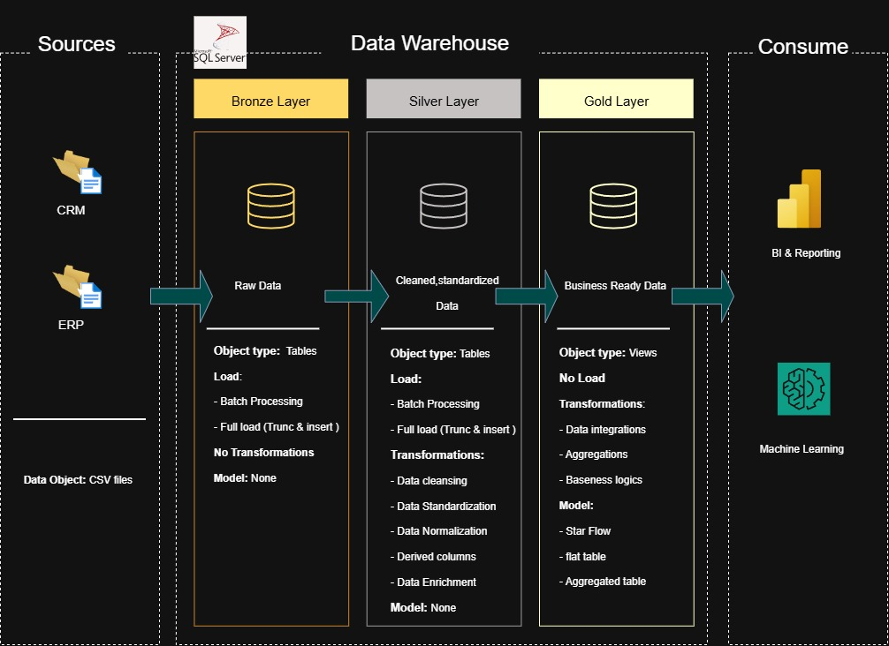
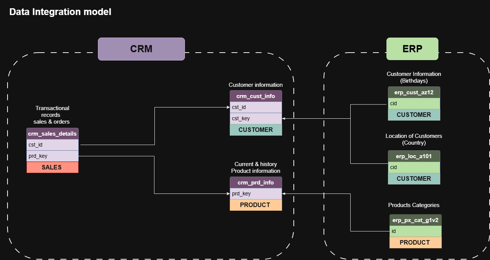
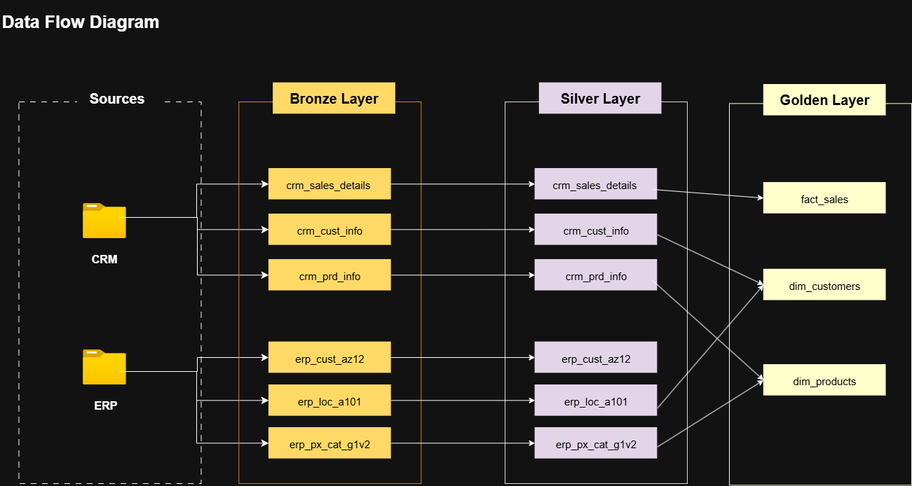
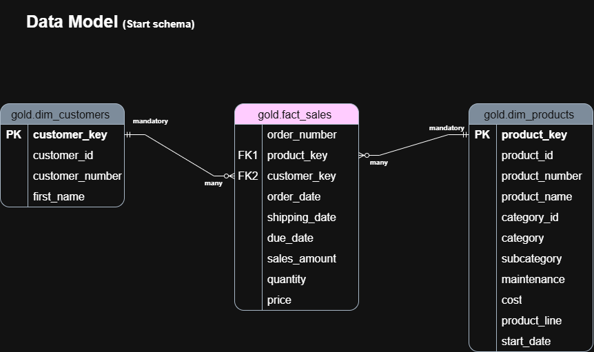

# End-to-End Sales Data Warehouse Using SQL Server (CRM & ERP Integration)

## Project Overview

This project demonstrates the design and implementation of an end-to-end Sales Data Warehouse using Microsoft SQL Server. It integrates data from CRM (Customer Relationship Management) and ERP (Enterprise Resource Planning) source systems through three warehouse layers: Bronze, Silver, and Gold.

The project covers data ingestion, data cleaning, transformation, data modeling, and preparation of business-ready data for analytics and reporting.

## Project Architecture

The following diagram illustrates the overall project architecture and the flow of data through the warehouse layers.

## Technologies & Tools

| Technology | Category | Purpose |
|---|---|---|
| **Microsoft SQL Server** | Database & ETL | Database creation, data storage, SQL transformations, and data loading |
| **Visual Studio Code** | Development Environment | SQL script development and project organization |
| **Draw.io** | Data Visualization | Designing architecture, data integration, and data model diagrams |
| **Git & GitHub** | Version Control | Source code management, version tracking, and project collaboration |

## Data Integration and Table Relationships

This diagram illustrates the relationships between tables and the integration of CRM and ERP source data.

## Project Naming Conventions

Consistent naming conventions are used for database objects, schemas, tables, views, and columns to improve readability and maintainability.

## Data Flow

The data flow diagram shows how data moves from the source systems through ingestion, cleaning, transformation, and preparation for analytics.

## Data Warehouse Layers

### 1. Bronze Layer — Raw Data Ingestion

**Purpose:** Store raw data from CRM and ERP source systems with minimal transformation.

Key activities:

- Analyze source systems and understand source data structures.
- Create the database, schemas, and tables using SQL DDL statements.
- Load source data into the data warehouse.
- Import CSV files into the Bronze schema using `BULK INSERT`.
- Develop stored procedures to automate data-loading processes.

### 2. Silver Layer — Data Cleaning and Transformation

**Purpose:** Clean, standardize, and validate raw data to prepare it for analytical use.

Key activities:

- Perform exploratory data analysis (EDA) to understand data distributions and quality issues.
- Add metadata and audit columns where appropriate.
- Perform data quality checks and transformations using SQL.
- Remove leading and trailing whitespace.
- Validate key fields for uniqueness and non-null values where required.
- Standardize data formats and values.
- Handle missing and invalid data.
- Identify and remove duplicate records.
- Create derived columns when needed.
- Use stored procedures to load cleaned and transformed data into the Silver schema.

### 3. Gold Layer — Data Modeling and Business-Ready Data

**Purpose:** Organize cleaned data into a model suitable for analytics and reporting.

Key activities:

- Design a star schema for sales analysis.
- Create the `gold.fact_sales` sales fact table.
- Create the `gold.dim_customers` and `gold.dim_products` dimension views.
- Join and integrate data using customer and product surrogate keys.
- Rename columns according to the project's naming conventions.
- Arrange columns consistently for readability and usability.
- Validate relationships between the fact table and dimension views.
- Prepare business-ready data for reporting and business intelligence tools.

#### Gold Layer Data Model

The star schema connects the Sales fact table to the Customer and Product dimensions using `customer_key` and `product_key`.

## Data Catalog

The data catalog documents the Gold layer objects, including column names, data types, descriptions, and relationships between the sales fact table and the customer and product dimensions.

## Project Goals

- Integrate data from multiple CRM and ERP source systems.
- Build a structured data warehouse using SQL Server.
- Apply ETL principles to organize and automate data ingestion and transformation.
- Improve data quality through cleaning, standardization, and validation.
- Design a star schema connecting sales data with customer and product dimensions.
- Prepare reliable, business-ready data for downstream analytics and reporting.
